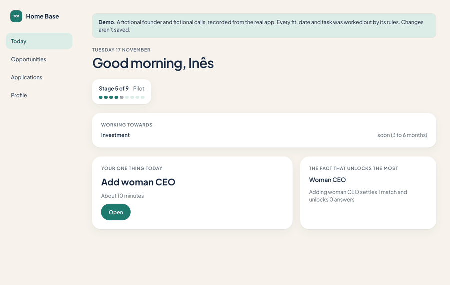
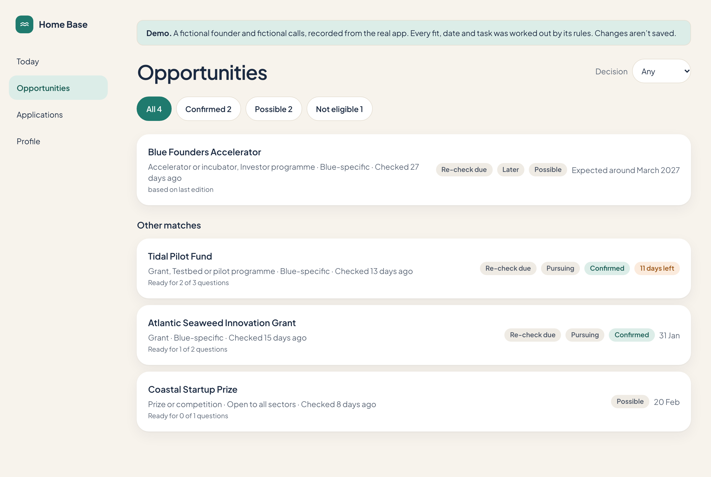
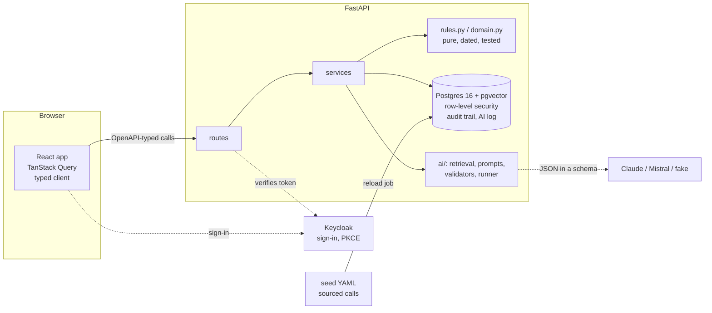

# Home Base

**Funding, matched and explained, for early-stage ocean startups.**

Home Base finds the grants, accelerators and pilot programmes an early-stage blue-economy
founder in Portugal or the EU qualifies for, says exactly why, and helps prepare the
application from facts the founder has approved. It shows one calm daily view of what to do
next, not a feed.

**[Try the demo →](https://ar10000.github.io/home-base-ocean-startup-funding/)**: a fictional founder and
fictional calls, recorded from the real app, AI answers included. No sign-up needed.



## Status

This is the Phase 1 MVP, paused before launch. It is a portfolio piece, not a live service.

| | |
|---|---|
| **Built and tested** | Rules, database and API; the web app's four screens and Profile; sign-in; tenant isolation; the AI layer with retrieval (drafts, "Why it fits", requirement extraction) and its evaluation set; CI with an end-to-end test |
| **Not built** | AI wording of Today's task sentence (it uses the spec's templates) |
| **Not done** | Real, hand-checked opportunities (only fictional ones ship); hosting; design partners |

The full plan, with what was ticked and what wasn't, is in [`docs/plan.md`](docs/plan.md).

## What it does

| Screen | |
|---|---|
| **Today** | One thing to do today, chosen by rules: a missing fact, a draft to review, a deadline. Two modes: *applying* when a deadline is close, *preparing* otherwise. |
| **Opportunities** | Every call, checked against the company's approved facts: Confirmed, Possible or Not eligible, with the call's own words quoted for each requirement. |
| **Opportunity** | "Why it fits" in two sentences, worded by AI from the calculated results and marked as AI; each requirement with the call's own words; freshness ("Source checked 12 days ago"), the founder's decision (Pursuing, Later, Not for us) and a dated history. |
| **Application** | The call's questions; "Draft with AI" from approved facts only, with the facts each answer was built from; autosaved edits, approval per answer, and "Mark as submitted". Nothing is ever submitted from the platform. |
| **Profile** | Company facts, all chosen from lists using the same words as the calls; a short knowledge base (what the company does, impact, team, traction) that drafts draw on; everything approved before it is used; goals with a time window; stage. |

<table>
  <tr>
    <td></td>
    <td></td>
  </tr>
  <tr>
    <td></td>
    <td></td>
  </tr>
</table>

## How it is built

The domain is one where a wrong answer costs a founder a deadline or a rejected
application. Every design choice serves one idea: **every status on screen can be traced
back to a written rule and a source.**

- **Code decides, AI explains.** Fit, freshness, priorities and progress are pure, tested
  functions. AI may only extract, judge soft criteria and word explanations. It never sets a
  status, date or score, and anything it writes is marked as AI.
- **No rule without a source.** Each of the 65 business rules has an ID (`REQ-09`,
  `PRI-14`…) in [`docs/rules/*.yaml`](docs/rules/), quotes the spec section it comes from,
  and lists examples that run as tests. [`scripts/check_rules.py`](scripts/check_rules.py)
  fails the build when a rule has no code or no test, or when code cites a rule that doesn't
  exist. The generated map is [`docs/rules/traceability.md`](docs/rules/traceability.md).
- **Ambiguity is written down.** Where the spec could be read two ways, the chosen reading
  is recorded with its date and who confirmed it: 85 decisions in
  [`docs/decisions.md`](docs/decisions.md). Technology choices are ADRs in
  [`docs/adr/`](docs/adr/).
- **Two layers of tenant isolation.** Every query filters by company, and Postgres
  row-level security enforces it again: the API runs as a restricted role with the company
  set per transaction. Tests try to cross tenants and must fail.
- **An append-only audit trail.** Every change to facts, decisions and answers is audited
  in the same transaction, and the opportunity history on screen is built from it.



### AI and retrieval

All model calls go through one module ([`api/src/home_base/ai/`](api/src/home_base/ai/)),
behind one interface with three providers: a fake for tests and CI, Claude for the demo and
evaluations (D-84), and Mistral for real founders' data (ADR-004, EU-only).

- **Retrieval (RAG).** Approved facts are embedded once into pgvector, under the same
  row-level security as the facts. A draft sends only the question's required facts plus the
  4 closest approved facts; extraction sends only the call's passages about eligibility.
  Embeddings run locally (bge-small-en-v1.5): nothing about a company leaves for them.
- **Grounded, or refused.** Output is JSON in a fixed schema, then validated in code. A
  draft is refused if it cites a fact it wasn't given (DRF-01) or states a number found in
  none of the facts its sentence cites. An extracted requirement is refused unless its quote
  is in the call word for word, and unless the seed loader itself would accept it. One retry
  with the reasons, then a visible failure; nothing is ever saved half-valid.
- **Traceable.** Every call is logged with its prompt version, model, input hash, references
  to the records it used (never their text), tokens, cost and outcome. Every draft links to
  the fact versions it cited (DRF-02). Same input, same answer: results are cached by hash.
- **Cheap by design.** A daily cost limit is enforced in code (0.10 EUR). One evaluation run
  plus recording the demo costs about 0.05 EUR on Claude Haiku 5.5; the demo replays
  recorded answers and calls no model.

Evaluation set: three fictional calls labelled by hand, scored against the handbook's
thresholds (recall of hard rules ≥ 95%, precision ≥ 90%, quotes verbatim 100%), each run
three times with fresh answers and judged on the worst run
([results](api/tests/evals/results/)):

| Prompt | Recall | Precision | Quotes verbatim | What changed |
|---|---|---|---|---|
| v1 | 93% | 100% | 100% | — |
| v2 | 100% (3 of 3 runs) | 100% | 100% | a scope sentence is a sector rule; quotes may span a line break (D-85) |

### Testing

| | |
|---|---|
| API | ~1,190 tests: catalogue examples, property tests (Hypothesis), and integration tests on a real Postgres 16 and Keycloak through Testcontainers. Branch coverage. |
| Mutation | `mutmut` over the rules and domain code: 90% of mutants killed, 100% for matching and Today. A CI job of its own. |
| Web | 136 Vitest + Testing Library tests against a fake API, typed from the OpenAPI schema. |
| End to end | Playwright plays the golden path against the full local stack in CI: sign up, set up a company, match, decide, apply. |
| Types | `mypy --strict` and TypeScript `strict` with `exactOptionalPropertyTypes`. The web client is generated from the API's OpenAPI schema, and CI fails if it drifts. |

## Stack

Python 3.12, FastAPI, SQLAlchemy 2, Alembic, Postgres 16 · React 19, TypeScript, Vite,
Tailwind 4, TanStack Query, React Router · Keycloak (OIDC with PKCE) · uv, Ruff, mypy,
pytest, Hypothesis, mutmut, Testcontainers, Vitest, Playwright · GitHub Actions ·
AI: Claude Haiku 5.5 (Anthropic SDK), pgvector, fastembed (bge-small-en-v1.5).

Vendors were picked EU-first (data in the EU, EU-owned where possible); see the ADRs.

## Run it locally

You need [uv](https://docs.astral.sh/uv/), Python 3.12+, Node 22.22+ and Docker.
Everything runs on your machine with fictional data only.

```sh
make setup       # install tools and git hooks
make dev-up      # Postgres and Keycloak in Docker, migrations, fictional opportunities
make demo-seed   # optional: the demo's six fictional calls instead
make dev-api     # API on 127.0.0.1:8000
make dev-web     # web app on http://localhost:5173: sign in, or register a new account
```

```sh
make all         # lint, strict types, rule traceability, unit + integration tests, web build
make mutation    # mutation tests on the rules
make e2e         # Playwright golden path against the local stack
make demo-build  # the static demo, over the recorded snapshot in web/src/demo/
```

AI runs on a fake provider by default: no key and no network, and its "drafts" only
restate your facts. To use Claude (D-84; fictional data only), put an Anthropic API key in a
file outside the repository, then pass `AI=anthropic`:

```sh
mkdir -p ~/.config/home-base
printf 'ANTHROPIC_API_KEY=%s\n' 'your-key' > ~/.config/home-base/anthropic.env
chmod 600 ~/.config/home-base/anthropic.env
make dev-api AI=anthropic   # or: make evals AI=anthropic
```

Embeddings run locally (bge-small-en-v1.5, downloaded once, 67 MB).

The local Keycloak realm (`infra/keycloak/home-base-dev.json`) has a test user,
`founder@example.test`, with a local-only password in that file.

## Layout

```
docs/spec/phase-1.md   what Phase 1 does: scope, data model, rules in prose
docs/handbook.md       how it is built: architecture, testing, security, AI rules
docs/rules/            the rule catalogue (YAML) and its generated traceability map
docs/decisions.md      every reading of the spec, dated, with who confirmed it
docs/adr/              technology decisions: context, options, decision, consequences
api/src/home_base/     core/, modules/<domain>/{rules,domain,service,repository}.py, api/
api/src/home_base/ai/  every model call: providers, prompts/<task>/v<n>.md, validators, retrieval
api/tests/evals/       the hand-labelled evaluation set and its results
api/alembic/           migrations (one concern each, in their own PRs)
api/tests/             unit, property and integration tests
web/src/               features/<screen>/, components/, lib/ (the one API client)
web/src/demo/          the public demo: a recorded snapshot and a stand-in for fetch
scripts/               rule traceability, mutation gate, seed loading, demo seed
```

## Licence

[MIT](LICENSE).
